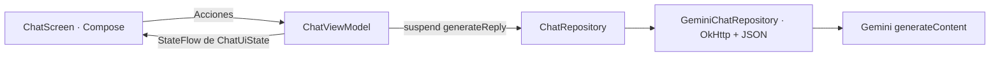

# MyUpcChat · Kotlin + Compose + Gemini

Proyecto didáctico de 90 minutos para participantes con Kotlin básico. Chat generativo real con Gemini, Material 3 y arquitectura MVVM. Solo falta configurar tu clave y personalizar la instrucción del asistente durante el taller.

## Puesta en marcha

1. Abre **esta carpeta** (`MyUpcChat`) en Android Studio.
2. Mantén la configuración de la base: AGP 9.4.1, Gradle 9.6.0, Kotlin 2.2.10, SDK 37 y toolchain Java 25. Instala el SDK que solicite Android Studio y permite que Gradle resuelva las dependencias. El código Java se compila con compatibilidad 11.
3. Sincroniza Gradle. Usa un dispositivo/emulador Android 7.0 (API 24) o posterior con Internet.
4. Puedes ejecutar la app sin clave: se muestra la bienvenida y un aviso de configuración; el envío permanece deshabilitado.
5. Obtén una clave en [Google AI Studio](https://aistudio.google.com/apikey). Comprueba acceso al modelo y cuota antes del taller; no se garantiza disponibilidad gratuita para todas las cuentas.
6. Añade estas líneas al `local.properties` de la raíz, **conservando el `sdk.dir` existente**, sin comillas:

   ```properties
   GEMINI_API_KEY=tu_clave_real
   GEMINI_MODEL=gemini-3.5-flash-lite
   ```

7. Sincroniza Gradle y vuelve a ejecutar la app. Estos valores se incorporan a `BuildConfig` al compilar; un simple reinicio no actualiza la clave.
8. Envía «Me llamo Alex» y luego «¿Cómo me llamo?». La segunda petición incluye el historial.

`local.properties.example` contiene una plantilla sin secretos. No pegues tu clave en archivos Kotlin, capturas, documentación ni en un repositorio. `.gitignore` ya excluye `local.properties`. La clave **sí queda dentro del APK**: este acceso directo es solo para la demo. Para publicar utiliza un backend o Firebase AI Logic; consulta las [indicaciones de Google](https://ai.google.dev/gemini-api/docs/api-key). No distribuyas un APK que contenga tu clave personal.

## Arquitectura y recorrido de lectura



| Archivo dentro de `app/src/main/java/com/example/myupcchat` | Responsabilidad |
|---|---|
| `MainActivity.kt` | Construcción manual de dependencias, ViewModel y observación del estado |
| `model/ChatMessage.kt` | Datos inmutables de los mensajes y autor |
| `ui/chat/ChatViewModel.kt` | Estado, envío, reintento y nueva conversación |
| `ui/chat/ChatScreen.kt` | Interfaz declarativa, sin acceso a red |
| `data/ChatRepository.kt` | Contrato de generación de respuestas |
| `data/GeminiChatRepository.kt` | HTTP cancelable, JSON, historial y traducción de errores |
| `data/AssistantConfig.kt` | Personalidad editable del asistente |

El estado baja a la interfaz; las acciones suben al ViewModel. `collectAsStateWithLifecycle` vincula la observación al ciclo de vida. `viewModelScope` mantiene el trabajo durante una rotación y lo cancela al destruir definitivamente el ViewModel. OkHttp realiza la red fuera del hilo principal y `suspendCancellableCoroutine` conecta su cancelación con la corrutina.

Las respuestas se muestran completas, como texto seleccionable. El historial solo vive en memoria: sobrevive a una rotación, pero se pierde al cerrar el proceso. No hay base de datos, login, voz, imágenes, streaming ni renderizador Markdown. «Nuevo chat» cancela HTTP y descarta respuestas antiguas. Si falla un envío, se conserva el historial anterior y se devuelve la pregunta al editor para corregirla o reintentar.

## Ejercicio de 10 minutos

1. Configura la clave como se indica arriba.
2. Busca `TODO(TALLER)` en `AssistantConfig.kt` y cambia rol, tono y formato.
3. Recompila, pulsa «Nuevo chat» y compara una misma pregunta con ambos prompts.

La [guía del instructor](docs/TALLER_90_MIN.md) incluye tiempos, explicaciones, preguntas, solución y alternativa sin Internet.

## Comprobaciones

En PowerShell, desde la raíz del proyecto:

```powershell
# Si JAVA_HOME no está configurado, usa el JBR de tu instalación de Android Studio.
$env:JAVA_HOME = 'C:/Program Files/Android/Android Studio/jbr'
.\gradlew.bat :app:assembleDebug :app:testDebugUnitTest :app:lintDebug --console=plain
.\gradlew.bat :app:assembleDebugAndroidTest --console=plain
# Con dispositivo o emulador conectado:
.\gradlew.bat :app:connectedDebugAndroidTest --console=plain
```

Las pruebas unitarias usan un repositorio falso y MockWebServer: no envían datos a Google ni necesitan una clave. Verifican contexto, reintento, doble envío, cancelación, formato JSON, autenticación por cabecera y errores de API. Las pruebas Compose comprueban entrada/envío, falta de clave y reinicio en tema oscuro.

También se comprueba que el borrador sobrevive a la recreación de la Activity y que el editor permanece visible al abrir el teclado software. El estado de las pruebas ejecutadas y las capturas están en [VALIDACION.md](docs/VALIDACION.md).

APK: `app/build/outputs/apk/debug/app-debug.apk`. Informe de pruebas: `app/build/reports/tests/testDebugUnitTest/index.html`. Informe lint: `app/build/reports/lint-results-debug.html`.

Antes de presentar, sigue [la lista de validación](docs/VALIDACION.md). La prueba real de Gemini requiere tu clave y cuota; las pruebas simuladas no confirman acceso a tu cuenta.

## Resolución de problemas

| Síntoma | Acción |
|---|---|
| Aviso de falta de clave | Revisa el archivo de la raíz, sincroniza y recompila |
| HTTP 400, 401 o 403 | Comprueba clave, permisos y configuración en AI Studio |
| HTTP 404 | Revisa `GEMINI_MODEL` y el catálogo disponible para tu cuenta |
| HTTP 429 | Espera o revisa cuota; no se reintenta automáticamente |
| Tiempo de espera o sin conexión | Revisa Internet y pulsa «Reintentar» |
| Respuesta bloqueada o vacía | Reformula la pregunta |
| Cambios de personalidad sin efecto claro | Recompila y empieza un chat nuevo; la generación no es determinista |

Referencias: [REST generateContent](https://ai.google.dev/api/generate-content), [modelos](https://ai.google.dev/gemini-api/docs/models), [Compose](https://developer.android.com/compose), [ViewModel](https://developer.android.com/topic/libraries/architecture/viewmodel).
